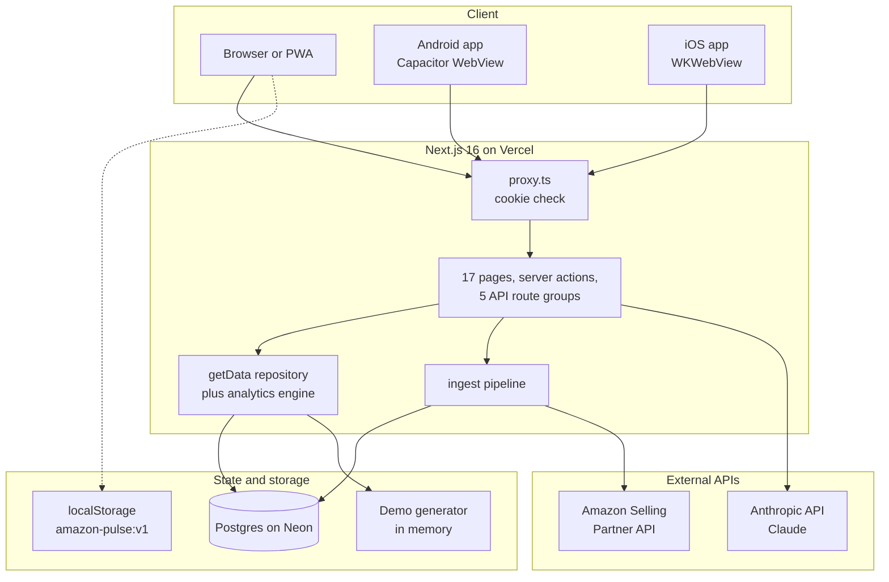
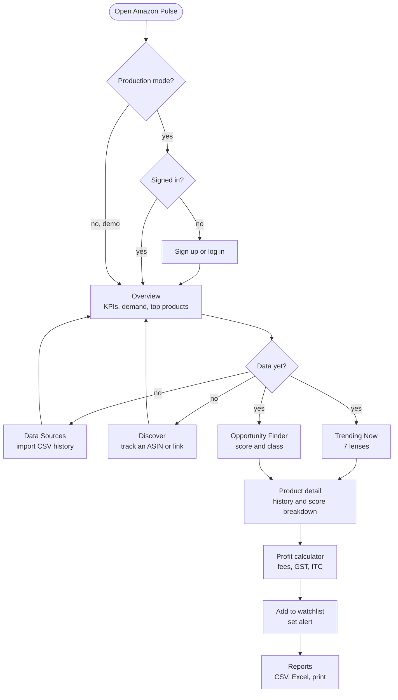
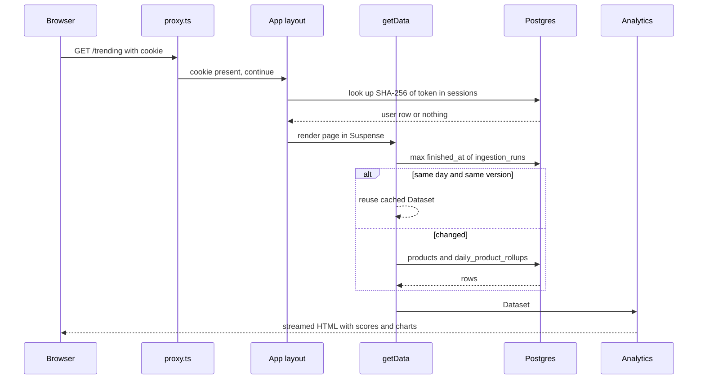
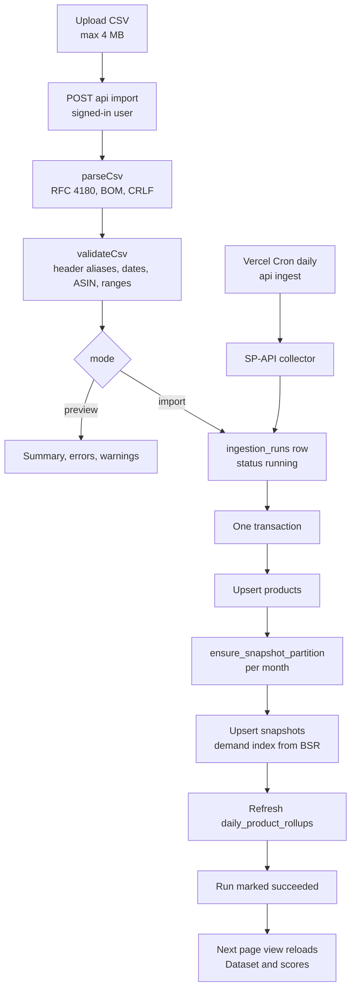
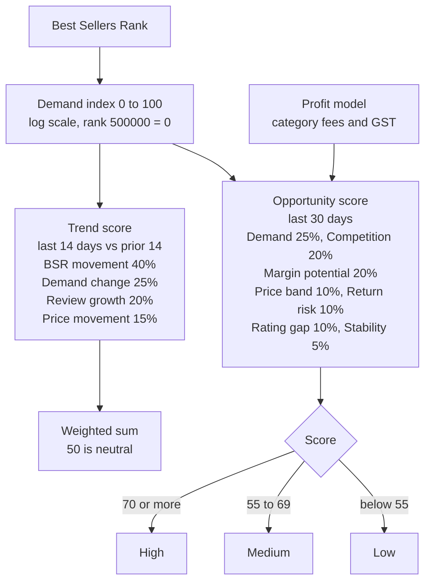
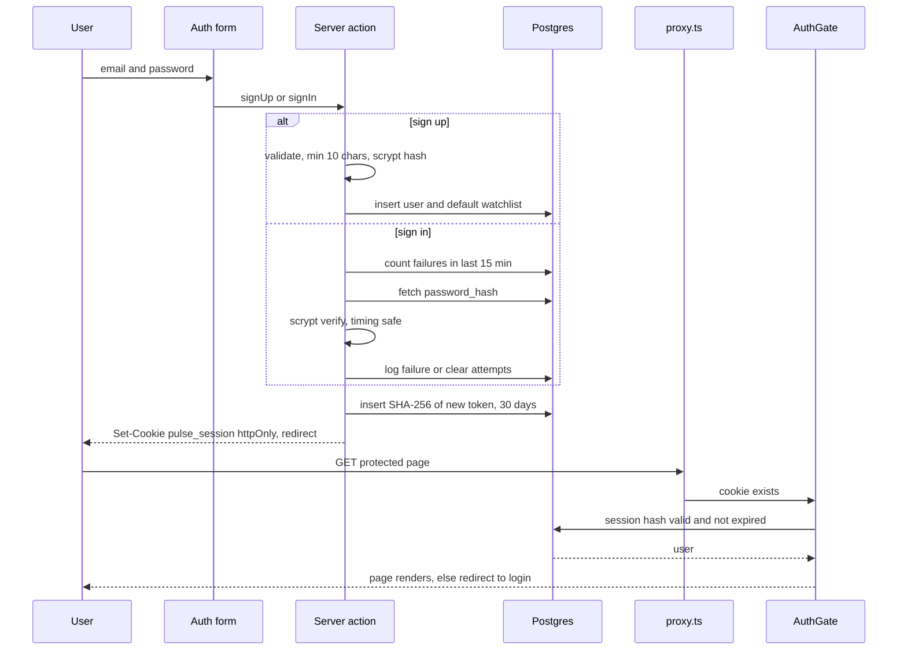
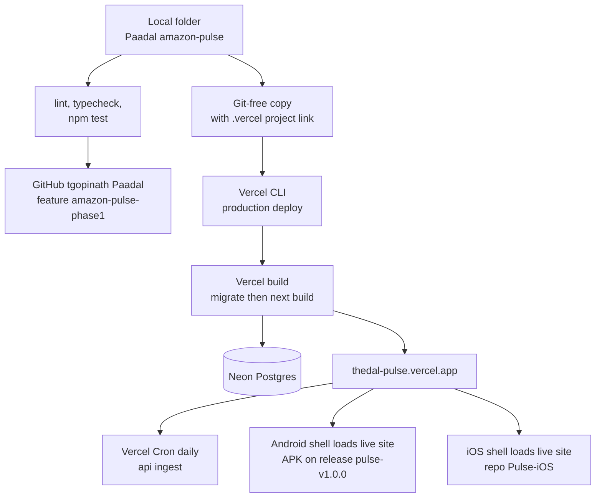

# Amazon Pulse: architecture

Amazon Pulse is a product-intelligence dashboard for sellers on Amazon India. It stores dated snapshots of product data (price, rating, reviews, Best Sellers Rank) from permitted sources only, and turns them into rankings, period comparisons, trend and opportunity scores, and GST-aware profit estimates. The main engineering idea is honesty about data: every number is labelled as verified sales, observed listing data, an estimate or an internal score; history comes only from snapshots actually captured; and demo data is synthetic, labelled, and kept out of production by the database itself.

| Platforms | Stack | Data | Hosting |
| --- | --- | --- | --- |
| Web (installable PWA), Android app, iOS app | Next.js 16 App Router, React 19, TypeScript, Tailwind 4, Recharts | PostgreSQL on Neon via postgres.js; partitioned snapshots and a daily rollup view | Vercel project thedal-pulse, deployed from the CLI; daily Vercel Cron |

## System architecture

The product rules, screen map, data model and scoring methods are written up in `docs/ARCHITECTURE.md` in the repo. This page covers how the system is built and runs.

It is one Next.js application. Pages are React Server Components that read data on the server and stream it in behind `<Suspense>`; charts and the watchlist are Client Components. All data access goes through one function, `getData()` in `src/lib/data/repository.ts`, which returns the same in-memory `Dataset` shape (products plus a per-product list of daily snapshots) in both modes:

- **Demo mode** (`APP_MODE` unset or `demo`): a deterministic synthetic catalogue built in memory by `demo-generator.ts`. ASINs start with `B0DEMO`, brands are invented, and every screen shows a "Demo data" banner.
- **Production mode** (`APP_MODE=production`): products plus one row per product per day from the `daily_product_rollups` materialised view in Postgres. Accounts are mandatory.

The analytics engine in `src/lib/analytics/` is a set of pure functions over that dataset, so the same code serves demo data, Postgres data and test fixtures. Writes (CSV import, the daily collector, "Track a product") all go through one function, `ingest()`.

*One Next.js app on Vercel. The repository picks demo or Postgres data; every write goes through ingest. The Kolam kits load from GitHub Pages in the page head. Dotted lines are client-side only.*

## Main user flow

The core job is "find a product worth selling, and check it would make money". In production a seller first signs up; in demo mode they land straight on the Overview.

*From signing in to a saved, watched product with a profit estimate.*

## Data flow and state

A page request in production: the proxy only checks that a `pulse_session` cookie exists; the app layout's `AuthGate` then validates it against the database. `getData()` caches the loaded dataset per server instance and reloads it only when the day (in IST) changes or a newer ingestion run has finished.

*Key request: a signed-in page view in production mode.*

| Where | What lives there |
| --- | --- |
| `users`, `sessions`, `login_attempts` | Accounts (scrypt hash), session token hashes with expiry, failed sign-ins for throttling |
| `products`, `categories` | Tracked ASINs (unique per marketplace) and 9 seeded categories |
| `product_snapshots` | Append-only observations, range-partitioned by month on `captured_at`; each row carries `data_source` and `source_confidence` |
| `daily_product_rollups` | Materialised view, one row per product per day; excludes `data_source = 'demo'`; refreshed concurrently after each ingest |
| `ingestion_runs` | Every collection or import job with status, counts and error, used for freshness and the run log |
| `watchlists`, `watchlist_products`, `alerts` | Account-backed watchlist, collections and threshold alerts |
| `cost_profiles` | Profit-calculator inputs saved per user and product, including fee and GST overrides |
| `user_reports` | Report history with the resolved date range, for re-download |
| `localStorage amazon-pulse:v1` | Watchlist, collections and alerts in demo mode or when signed out; the comparison tray (up to 5 products) always |
| `pulse_session` cookie | Random 32-byte session token; httpOnly, SameSite=Lax, Secure in production, 30 days |
| Server memory | The cached `Dataset`, and the per-instance AI rate limiter |
| Service worker cache `pulse-v1` | Hashed static assets, icons and the offline page |

### CSV import pipeline

Historical data comes in as CSV on the Data Sources page. The same pure validator runs for the preview and for the import, so what you preview is exactly what is written. Rows are rejected rather than guessed: no valid date or ASIN, a future date, or an out-of-range number drops the row with a line-numbered error. The daily cron and "Track a product" feed the same `ingest()` function.

*CSV and scheduled collection share one write path. On error the run is marked failed and the transaction rolls back.*

Details from the code: headers are normalised and mapped through aliases (for example `bsr`, `sales_rank` and `best_sellers_rank` all map to one field; `mrp` to `list_price`). Dates accept `YYYY-MM-DD`, ISO timestamps and Indian day-first `DD/MM/YYYY`. Duplicates of the same ASIN and day keep the later row. Limits are 4 MB and 100,000 rows per file. Snapshots are stored at noon IST of the given date; a re-import fills missing fields with `COALESCE` rather than overwriting known values with nulls.

### Scoring

All scores are computed in `src/lib/analytics/` and shown with every input, so a seller can see why a product scored as it did.

*Each signal is mapped to 0 to 100 by a bounded transform, then weighted.*

- **Demand index** (`demand.ts`): `100 × (1 − log10(BSR) / log10(500,000))`, clamped to 0–100. It is relative popularity, not units sold, and the UI and AI prompt say so.
- **Trend score** (`engine.ts trendScore`): needs at least a third of each window to have snapshots, otherwise it reports "insufficient" instead of a number. BSR uses a log ratio of mean ranks, reviews a log2 ratio of reviews gained, and a price drop counts as a mild positive.
- **Opportunity score** (`engine.ts opportunity`): needs at least 10 days of snapshots in the last 30. Margin potential runs the real profit model with a category's typical cost ratio, referral fee and GST rate. The explanation names the two strongest signals and the weakest factor.
- **Trending lenses** (`trending.ts`): today, this week, this month, fastest growing (30-day BSR gain), seasonal (same weeks last year), newly popular (first seen in 120 days), consistently popular (in the daily top 25 on 60% or more of covered days in 180).

### Profit calculator

`profit.ts calculateProfit` models one unit sold on Amazon.in. The selling price includes GST, so net revenue is `price ÷ (1 + GST rate)`. The referral fee is taken on the GST-inclusive price, plus a closing fee, plus 18% GST on those fees. If the seller claims input tax credit, purchase GST and fee GST are recoverable and are not costs; without ITC both are. TCS (0.5%) and TDS under Sec. 194-O (0.1%) are shown as cash withheld, not expenses. It also returns gross profit, net profit, margin and a break-even purchase cost. Signed-in users' inputs are saved per product in `cost_profiles` by a server action.

### Authentication

Accounts are hand-built, with no auth library or OAuth. Passwords are hashed with Node's `scrypt` (N=32768, r=8, p=1, 16-byte salt, 64-byte key) and compared with `timingSafeEqual`; an unknown email is checked against a dummy hash so it takes as long as a wrong password. Sign-in is throttled to 5 failures per email and 30 per IP in 15 minutes. The cookie is first-party and httpOnly, which is why the same login works in a browser and in both app WebViews.

*Only a hash of the session token is stored, so a database leak does not expose live sessions.*

API routes without a cookie get a JSON 401 from the proxy; route handlers check the session again themselves. Changing the password deletes all of the user's sessions and starts a fresh one. Deleting the account (type DELETE and the password) cascades to sessions, watchlists, alerts, saved costs and report history; shared product data stays. Post-login redirects only accept same-site relative paths.

## Key modules

| File / module | Responsibility |
| --- | --- |
| `src/app/(app)/*` | 17 App Router pages including Overview, Products, Product detail, History, Trending, Categories, Compare, Opportunities, Watchlist, Reports, AI, Data Sources, Discover, Settings, Profile |
| `src/app/(auth)/actions.ts` | Sign up, sign in with throttling, sign out (server actions) |
| `src/proxy.ts` | Next 16 proxy: optimistic cookie check in production; redirects to `/login?next=` or returns 401 for APIs |
| `src/lib/auth/` | `password.ts` scrypt hashing; `session.ts` cookie, session rows, `getCurrentUser` |
| `src/lib/db.ts` | Shared `postgres` (postgres.js) pool; disables prepared statements on Neon `-pooler` URLs; parses NUMERIC to numbers |
| `src/lib/data/repository.ts` | `getData()`: demo or Postgres dataset, cached by day and data version |
| `src/lib/data/ingest.ts` | The one write path: run log, product upsert, partitions, snapshot upsert, rollup refresh |
| `src/lib/data/demo-generator.ts` | Seeded synthetic history from 2025-03-01 with sale events, festival peaks and a simulated 4-day outage |
| `src/lib/csv.ts` | CSV parser, validator and template |
| `src/lib/analytics/` | `engine.ts` periods, rankings, coverage, trend, seasonality, opportunity; `trending.ts`, `profit.ts`, `overview.ts`, `explorer.ts`, `narrative.ts` |
| `src/lib/providers/` | Provider registry and status; `sp-api.ts` Login with Amazon, Sales and Traffic report, Catalog Items, Product Pricing, catalog search |
| `src/lib/ai/` | `tools.ts` 7 tools over the analytics engine; `assistant.ts` Claude tool runner with a Zod answer schema |
| `src/lib/client-store.ts` | Client watchlist store: localStorage, or optimistic updates synced to `/api/watchlist` when signed in |
| `src/lib/reports.ts`, `reports-xlsx.ts` | Report building, CSV and Excel (ExcelJS) export; DEMO in file names for demo data |
| `src/components/shell/native-shell.tsx` | Switches on Material 3 bars in the Android app or HIG bars in the iOS app; null in browsers |
| `db/migrations/`, `scripts/migrate.mts` | Plain SQL schema, applied in order in transactions and tracked in `schema_migrations` |

## Platforms

- **Web and PWA.** Responsive shell: sidebar on desktop, 5-tab bottom bar on mobile. Web manifest from `src/app/manifest.ts` with icons and shortcuts, and a hand-written service worker. The product uses its own light design (blue accent, Geist type) and is light-only: the root sets `data-theme="light"`.
- **Android.** A remote Capacitor shell in `android-wrappers/pulse` (`com.gopinath.pulse`) whose `server.url` loads `https://thedal-pulse.vercel.app` and appends `AmazonPulse-Android` to the user agent. `MainActivity` is a plain `BridgeActivity`. Inside it, the Kolam M3 kit tags `html.k-android` and `native-shell.tsx` sets up a Material 3 top app bar, navigation bar (Home, Discover, Trends, Watchlist, More) and Back; `public/native.css` maps the product's tokens to M3 colour roles and shapes. The APK is on the Paadal release `pulse-v1.0.0`.
- **iOS.** A SwiftUI app in the `tgopinath/Pulse-iOS` repo: a `WKWebView` on the live site with the user-agent token `AmazonPulse-iOS`, an injected `window.KolamShell`, edge-swipe back, haptics from the page, outside links in Safari's viewer and a native offline screen. The Kolam iOS kit tags `html.k-ios` and gives large titles, a tab bar and back with a centred title. Both apps stay light.

The two kits are loaded as plain scripts from the Kolam design system on GitHub Pages in the root layout, so they can tag `<html>` before first paint. In a normal browser neither turns on and the website keeps its own header, sidebar and bottom bar.

## Data sources and APIs

| Source | Used for | Licence / key |
| --- | --- | --- |
| Amazon Selling Partner API | Daily: yesterday's verified units from the Sales and Traffic report; title, brand, category, image and BSR from Catalog Items; price from Product Pricing. Also keyword search and "Track a product" on Discover | Seller's own account. `SPAPI_LWA_CLIENT_ID`, `SPAPI_LWA_CLIENT_SECRET`, `SPAPI_REFRESH_TOKEN`; optional `SPAPI_MARKETPLACE_ID`, `SPAPI_ENDPOINT`, `SPAPI_MAX_ASINS` (default 40) |
| CSV import | User-uploaded history | None |
| Product Advertising API 5.0 | Listed in the provider registry; adapter not implemented | `PAAPI_ACCESS_KEY`, `PAAPI_SECRET_KEY`, `PAAPI_PARTNER_TAG`, `PAAPI_HOST` |
| Licensed research API | Listed in the provider registry; adapter not implemented | `RESEARCH_API_PROVIDER`, `RESEARCH_API_KEY` |
| Anthropic API | Amazon Pulse AI: model `claude-opus-5-5` via `@anthropic-ai/sdk` tool runner, up to 8 tool iterations, medium effort, structured JSON answer (summary, metrics, products, period, freshness, limitations) | `ANTHROPIC_API_KEY`; `AI_QUESTIONS_PER_HOUR` (default 30) |
| Postgres on Neon | All production data | `DATABASE_URL` (pooled), `DATABASE_URL_UNPOOLED` (migrations), `DATABASE_POOL_MAX` |
| Vercel Cron | Calls `/api/ingest` daily at 01:17 UTC (06:47 IST) | `CRON_SECRET` as a Bearer token, compared in constant time |
| Kolam design system | M3 and iOS kits for the apps | Gopinath's own, public |

The AI never uses outside knowledge: its system prompt tells it to state only figures returned by its 7 tools (period ranking, product search, trending, category performance, product detail, compare, opportunities), to say "demo data" when the data is synthetic, and to call the demand index an estimate. Answers are checked against the Zod schema before they are shown. There is no scraping of Amazon pages anywhere in the code.

## Offline, performance, privacy and accessibility

- **Offline.** The service worker serves `/_next/static/` and icons cache-first and pages network-first; when offline, navigations get `offline.html`. Analytics are never served stale. The iOS shell shows its own "You're offline" screen with Try Again.
- **Performance.** `cacheComponents` and partial prefetching are on; every data view streams behind a skeleton. The analytics engine runs in memory over daily rollups and reloads only when data changes, which the code notes suits a few thousand products.
- **Privacy and security.** Credentials are read only on the server; the Data Sources page shows whether each variable is set, never its value. Session tokens are stored hashed. Every watchlist statement is scoped to the signed-in user. The AI route limits questions to 500 characters and a per-user hourly quota.
- **Data honesty.** Period reports read only snapshots inside the period, state coverage ("18 of 31 days"), and show "Historical data not available" when there are none. Demo rows are excluded from the production rollup view.
- **Accessibility.** A skip link to `#main`, a `role="note"` demo banner, labelled loading states in the iOS shell. The repo's own design notes target WCAG AA contrast and 44 px touch targets; that was not measured for this page.

## Build and deploy

`npm run build` first runs `scripts/migrate.mts --if-configured`, which applies pending SQL migrations over the direct (unpooled) connection, or skips when no database is set, then `next build`. The Vercel project is not connected to git: production is deployed with the Vercel CLI from a git-free copy of the `amazon-pulse` folder, so pushing to GitHub does not deploy. Tests use `node:test` via `tsx`: 29 unit tests across analytics, CSV, AI tools and SP-API, plus 5 database integration tests run against a disposable database.

*GitHub holds the source; the CLI deploy is what reaches production. Both app shells pick up web changes without a new build.*

## Known limits and next steps

- PA-API and licensed research adapters are registered but not implemented; the cron skips them.
- Alerts are evaluated daily and record `last_triggered_at`, but nothing is delivered by email or push yet.
- The AI rate limiter is in memory per server instance, so it is not shared across instances.
- The in-memory analytics engine will need to move into SQL over the same rollup view for large catalogues.
- Referral and closing fee tables are editable estimates that sellers must check against Amazon's current fee schedule.
- SP-API pricing is capped at `SPAPI_MAX_ASINS` per run because of Amazon's rate limits.
- Not verified from code: which `APP_MODE` and which optional credentials are set on the live deployment. The registry says the live site requires sign-up, which matches production mode.

---

Written from the source code on 17 November 2026. Source: [github.com/tgopinath/Paadal](https://github.com/tgopinath/Paadal/tree/feature/amazon-pulse-phase1/amazon-pulse) (amazon-pulse/, branch feature/amazon-pulse-phase1); iOS shell: github.com/tgopinath/Pulse-iOS
